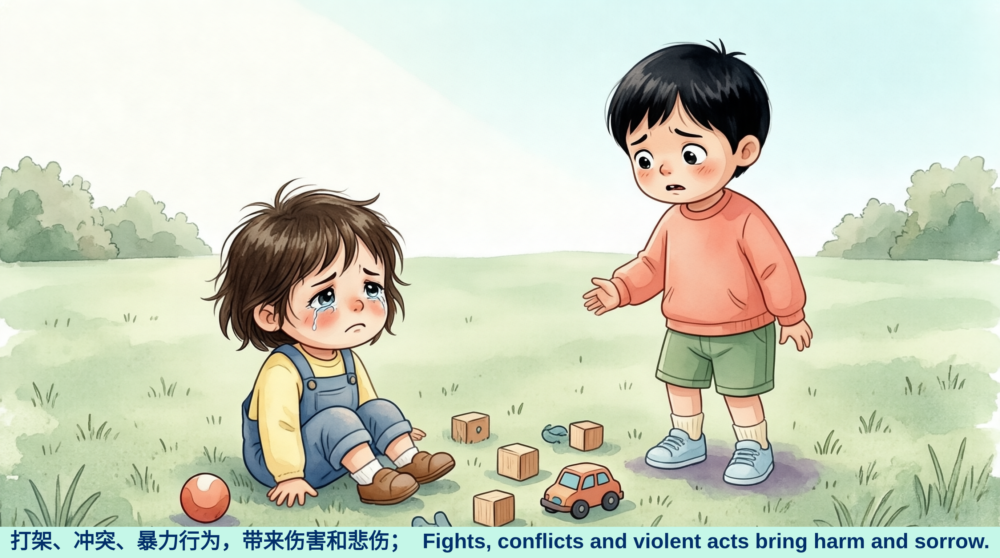
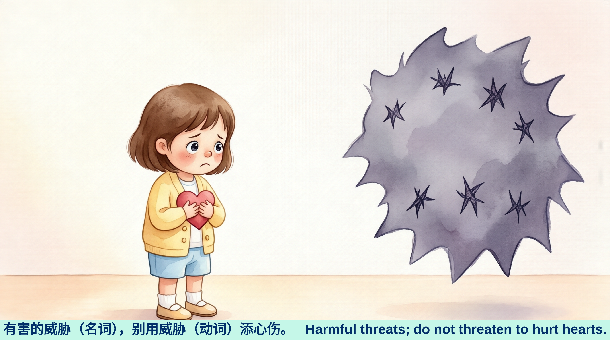
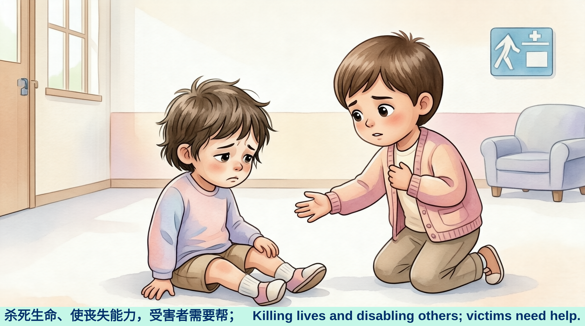
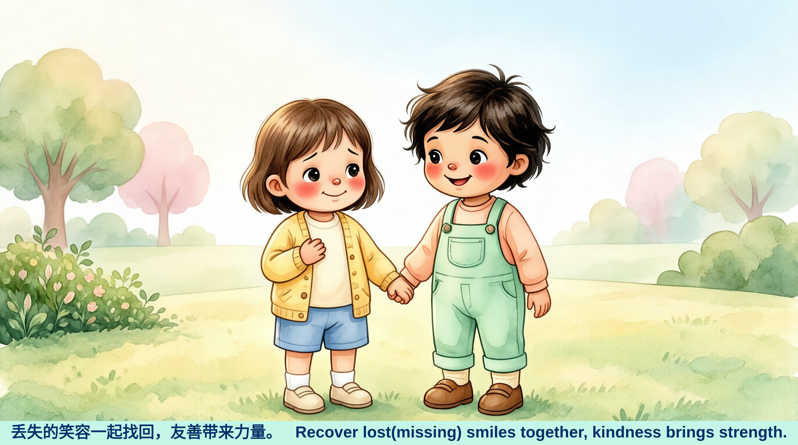
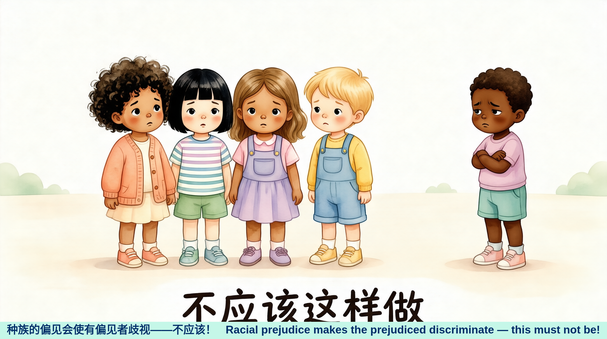
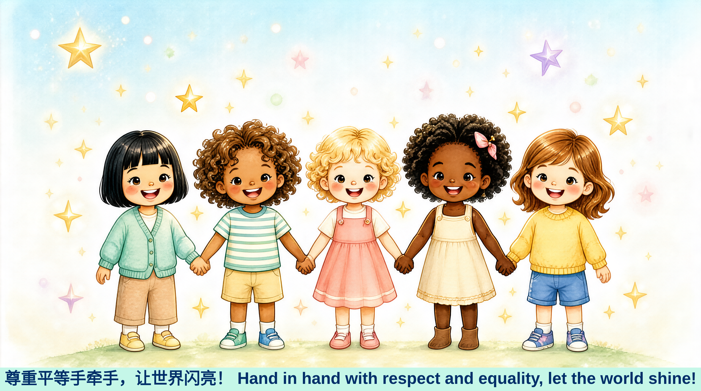

# 社会冲突 · 拒绝伤害

> 38天背完高考3500词系列 · 第2天 · 主题：社会冲突

---

## 📚 单词列表

打架、杀死、伤害、有害的、冲突、暴力行为、威胁（名词）、威胁（动词）、丢失的、使丧失能力、受害者、使有偏见、偏见、种族的、歧视

---

## 🎵 《拒绝伤害》

打架、冲突、暴力行为，带来伤害和悲伤；  
有害的威胁（名词），别用威胁（动词）添心伤。  
杀死生命、使丧失能力，受害者需要帮；  
丢失的笑容一起找回，友善带来力量。  
种族的偏见会使有偏见者歧视——不应该！  
尊重平等手牵手，让世界闪亮！

---

## 📖 中英对照与绘本

### 第1幅 · 冲突带来伤害

> 打架、冲突、暴力行为，带来伤害和悲伤；
> Fights, conflicts and violent acts bring harm and sorrow.

▶️ [听朗读](1.mp3)

---

### 第2幅 · 有害的威胁

> 有害的威胁（名词），别用威胁（动词）添心伤。
> Harmful threats; do not threaten to hurt hearts.

▶️ [听朗读](2有.mp3)

---

### 第3幅 · 受害者需要帮助

> 杀死生命、使丧失能力，受害者需要帮；
> Killing lives and disabling others; victims need help.

▶️ [听朗读](3杀.mp3)

---

### 第4幅 · 找回丢失的笑容

> 丢失的笑容一起找回，友善带来力量。
> Recover lost(missing) smiles together, kindness brings strength.

▶️ [听朗读](4丢.mp3)

---

### 第5幅 · 拒绝种族歧视

> 种族的偏见会使有偏见者歧视——不应该！
> Racial prejudice makes the prejudiced discriminate — this must not be!

▶️ [听朗读](5种.mp3)

---

### 第6幅 · 尊重平等，让世界闪亮

> 尊重平等手牵手，让世界闪亮！
> Hand in hand with respect and equality, let the world shine!

▶️ [听朗读](6尊.mp3)

---

## 📁 文件说明

| 文件 | 说明 |
|------|------|
| `社会冲突` | 主题源文件，包含单词表、歌词及AI绘画提示词 |
| `1.png` ~ `6尊.png` | 6幅儿童绘本风格的AI插画（16:9 水彩质感） |
| `1.mp3` ~ `6尊.mp3` | 与插画对应的音频朗读文件 |
| `README.md` | 本说明文件 |

---

## 📂 系列目录

1. [社会问题](../) → **2. 社会冲突** ← 本页

---

## 💝 欢迎捐款

如果这份学习资料对你有帮助，欢迎请作者喝杯茶 🍵！

| 微信收款 | 支付宝收款 |
|:--------:|:----------:|
|  |  |

感谢支持！你的鼓励是持续创作的动力 🙏
